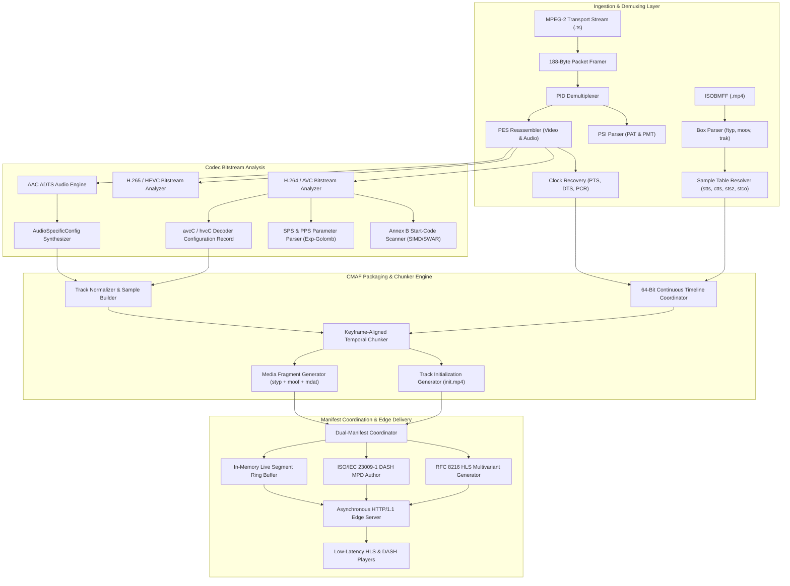

# Venturi

> A high-throughput streaming media transmuxer, live segmented packager, and adaptive edge delivery engine written in Factor, accelerated with C99 SIMD fast paths and verified with a Python validation test harness.

```
                  _             _ 
__   _____ _ __  | |_ _   _ _ __(_)
\ \ / / _ \ '_ \ | __| | | | '__| |
 \ V /  __/ | | || |_| |_| | |  | |
  \_/ \___|_| |_(_)__|\__,_|_|  |_|
```

Venturi is an original streaming media engine engineered from first principles in the **Factor** concatenative programming language. It demuxes broadcast MPEG-2 Transport Streams (`.ts`) and monolithic MP4 containers (`.mp4`), parses raw video and audio codec bitstreams (H.264/AVC, H.265/HEVC, AAC ADTS, ID3v2), slices frames into keyframe-aligned CMAF chunks, authors synchronized RFC 8216 HLS and ISO/IEC 23009-1 DASH manifests, and serves live or on-demand streams over an integrated asynchronous HTTP/1.1 edge server with RFC 7233 byte-range acceleration.

---

## Technical Highlights

* **Zero-Transcode Transmuxing**: Repackages broadcast MPEG-2 TS elementary streams directly into fragmented MP4 containers without re-encoding, preserving exact original picture fidelity while eliminating transcoding compute overhead.
* **CMAF Unified Distribution**: Adheres strictly to the Common Media Application Format (ISO/IEC 23000-19), producing a single set of media fragments (`init.mp4`, `.m4s`) consumed simultaneously by Apple HLS and MPEG-DASH players.
* **C99 SIMD / SWAR Bitstream Fast Path**: Leverages ARM64 NEON, x86-64 AVX2, and 64-bit SWAR (SIMD Within A Register) zero-byte detection algorithms to scan Annex B NAL start codes and strip emulation prevention bytes at **4.0+ GB/sec**.
* **Keyframe-Aligned Temporal Chunking**: Detects closed IDR keyframe boundaries and synchronizes incommensurate audio frame cadences, eliminating media clock drift across extended 24/7 continuous broadcasts.
* **64-Bit Continuous Timeline & Rollover Compensation**: Tracks presentation timestamps across 33-bit hardware counter rollovers (occurring every 26.5 hours in MPEG-2 TS feeds), ensuring strictly monotonic `baseMediaDecodeTime` values in `tfdt` atoms.
* **Dual-Manifest Coordination**: Authors RFC 8216 HLS (Version 7) multivariant master and sliding-window media playlists alongside ISO/IEC 23009-1 DASH XML MPDs with run-length compressed `SegmentTimeline` tags.
* **Asynchronous Edge Streaming Server**: Non-blocking TCP connection multiplexer with an in-memory live segment ring buffer, O(1) asset dispatch, RFC 7233 byte-range slicing (HTTP 206 Partial Content), and full CORS preflight support.
* **Exhaustive Multi-Tier Verification**: 336 unit, integration, and bitstream structure tests passing with zero failures across Factor, C99, and Python test suites.

---

## Architectural Overview



For complete technical specifications, see:
* [Architecture & Internal Systems Design](docs/ARCHITECTURE.md)
* [ISOBMFF & CMAF Box Specification Reference](docs/ISOBMFF_SPEC.md)
* [MPEG-2 Transport Stream Specification Reference](docs/MPEGTS_SPEC.md)
* [CMAF Packaging Principles & Chunking Architecture](docs/CMAF_PACKAGING.md)
* [Streaming Protocols: RFC 8216 HLS & ISO/IEC 23009-1 DASH](docs/STREAMING_PROTOCOLS.md)
* [Verification & Performance Telemetry Report](docs/VERIFICATION_REPORT.md)

---

## Performance Telemetry

Benchmarks executed on Apple Silicon (ARM64) running macOS Darwin:

| Benchmark Subsystem | Workload / Test Target | Throughput Metric | Latency Metric |
| :--- | :--- | :---: | :---: |
| **C99 SIMD / SWAR Scanner** | 50 MB raw bitstream with 51,200 NAL units | **4,020 MB/sec** (3.93 GB/s) | 12.44 ms total |
| **ISOBMFF Box Serializer** | 20,000 iterative `moof` + `mdat` containers | **1,175,724 ops/sec** | 0.85 us per box |
| **CMAF Transmuxing Engine** | 3,000 video frames at 60 fps (50.0 sec) | **302,477 frames/sec** | **5,041x real-time** |
| **HTTP Edge Route Dispatcher** | 100,000 requests with Range parsing & slicing | **27,552 req/sec** | **36.29 us / req** |

---

## Project Structure

```
venturi/
├── benchmarks/                        # Comprehensive microbenchmark harness
│   └── bench_suite.factor             # Standalone high-throughput benchmarking suite
├── c_src/                             # C99 SIMD / SWAR fast-path acceleration
│   ├── Makefile                       # Shared library and benchmark build targets
│   ├── bench_simd.c                   # C99 standalone verification & microbenchmarks
│   ├── venturi_simd.c                 # NEON, AVX2, and 64-bit SWAR algorithms
│   └── venturi_simd.h                 # C API declarations
├── docs/                              # In-depth architectural & protocol specifications
│   ├── ARCHITECTURE.md                # System layers, dataflow, and design rationale
│   ├── CMAF_PACKAGING.md              # Chunking rules, timeline sync, and dual-delivery
│   ├── ISOBMFF_SPEC.md                # ISO/IEC 14496-12 and 23000-19 box specifications
│   ├── MPEGTS_SPEC.md                 # ISO/IEC 13818-1 188-byte packet framing & PSI
│   ├── STREAMING_PROTOCOLS.md         # RFC 8216 HLS and ISO/IEC 23009-1 DASH MPD rules
│   └── VERIFICATION_REPORT.md         # Full test suite telemetry and pass logs
├── python/                            # Python Client SDK & Bitstream Validator
│   ├── pyproject.toml                 # Modern Python packaging configuration
│   ├── setup.py                       # Python setuptools metadata
│   ├── test_venturi.py                # End-to-end Python test runner & TS generator
│   └── venturi_sdk/                   # Client library & bitstream validation engine
│       ├── __init__.py                # Package exports
│       ├── client.py                  # HTTP streaming client with Range support
│       ├── media_generator.py         # Broadcast MPEG-TS & Annex B stream synthesizer
│       └── validator.py               # Deep ISOBMFF box hierarchy & TS continuity checker
├── scripts/                           # Automated developer workflows
│   └── verify.sh                      # Unified verification runner (C, Factor, Python)
├── venturi/                           # Core Factor implementation
│   ├── cli/                           # Subcommand implementations
│   │   ├── benchmark/                 # Microbenchmark runner
│   │   ├── inspect/                   # Deep container probe
│   │   ├── package/                   # Transmux & packaging command
│   │   └── serve/                     # HTTP/1.1 edge server launcher
│   ├── codecs/                        # Bitstream analysis & parameter set parsers
│   │   ├── aac/                       # ADTS parsing & AudioSpecificConfig synthesizer
│   │   ├── h264/                      # Annex B, SPS/PPS Exp-Golomb, avcC record
│   │   ├── h265/                      # HEVC NAL parsing, SPS, hvcC record
│   │   ├── id3/                       # ID3v2 timed metadata tag generation
│   │   └── simd/                      # Factor FFI bindings to C99 SIMD shared library
│   ├── common/                        # Shared low-level primitives
│   │   ├── bitstream/                 # Arbitrary-width bitstream reader/writer
│   │   ├── crc/                       # Table-driven IEEE 802.3 and MPEG-2 CRC-32
│   │   ├── exp-golomb/                # Unsigned and signed Exponential-Golomb decoders
│   │   ├── types/                     # Core domain tuples and immutable data models
│   │   └── utils/                     # Binary big-endian helpers and FourCC conversions
│   ├── isobmff/                       # Complete ISO/IEC 14496-12 box engine
│   │   ├── box-reader/                # Recursive container traversal
│   │   ├── box-writer/                # Declarative box serialization
│   │   ├── constants/                 # Canonical FourCC atom constants
│   │   ├── demuxer/                   # Monolithic MP4 demuxer and sample extractor
│   │   ├── headers/                   # mvhd, tkhd, mdhd, hdlr parser/writers
│   │   ├── movie-fragment/            # moof, traf, tfhd, tfdt, trun builders
│   │   ├── sample-tables/             # stts, ctts, stsz, stsc decoders
│   │   └── track-offsets/             # stco and co64 32/64-bit offset resolvers
│   ├── manifests/                     # Dual HLS and DASH playlist generation
│   │   ├── coordinator/               # Synchronous dual-manifest coordinator
│   │   ├── dash/                      # ISO/IEC 23009-1 XML MPD authoring
│   │   └── hls/                       # RFC 8216 master and live sliding window playlists
│   ├── mpegts/                        # Complete ISO/IEC 13818-1 transport stream engine
│   │   ├── constants/                 # PIDs, stream types, table IDs
│   │   ├── demuxer/                   # Continuous broadcast demuxer
│   │   ├── packet/                    # 188-byte packet framer and PCR decoder
│   │   ├── pes/                       # PES packet reassembler and 33-bit clock recovery
│   │   └── psi/                       # PAT and PMT decoders with CRC-32 checking
│   ├── packaging/                     # CMAF fragment assembly & timeline coordination
│   │   ├── chunker/                   # Keyframe-aligned temporal chunker
│   │   ├── cmaf/                      # init.mp4 and media fragment (.m4s) assemblers
│   │   ├── pipeline/                  # End-to-end transmuxer connecting demuxer and packager
│   │   └── timeline/                  # 64-bit continuous timeline & rollover compensation
│   ├── server/                        # Asynchronous edge delivery server
│   │   ├── handler/                   # HTTP parser, response serializer, CORS, MIME
│   │   ├── http-server/               # Non-blocking threaded TCP edge server
│   │   ├── live-stream/               # In-memory circular live segment ring buffer
│   │   └── range-requests/            # RFC 7233 byte-range parsing and slicing
│   ├── tests/                         # Exhaustive unit & integration test suites
│   │   ├── codecs/                    # Codec bitstream unit tests
│   │   ├── common/                    # Bitstream, Exp-Golomb, and CRC unit tests
│   │   ├── harness/                   # Zero-dependency test assertion framework
│   │   ├── integration/               # Full end-to-end transmux & HTTP edge tests
│   │   ├── isobmff/                   # ISOBMFF box and sample table unit tests
│   │   ├── manifests/                 # HLS and DASH manifest unit tests
│   │   ├── mpegts/                    # MPEG-2 TS packet and PES unit tests
│   │   ├── packaging/                 # CMAF chunking and fragment assembly unit tests
│   │   └── server/                    # HTTP range requests and live buffer unit tests
│   └── venturi.factor                 # Main unified CLI router and entrypoint
├── Makefile                           # Unified developer build automation
└── README.md                          # Project documentation
```

---

## Quickstart & Installation

### Prerequisites
* **Factor**: Native binary installed at `/Applications/factor/factor` or available on system `$PATH` (tested on Factor 0.102).
* **C Compiler**: Any standard C99 compiler (`clang` or `gcc`) for SIMD acceleration.
* **Python**: Python 3.8+ for the validation test suite (zero external dependencies required).

### Building the C99 SIMD Accelerator
```bash
make simd
```
This compiles `c_src/libventuri_simd.dylib` (or `.so`) and runs the SIMD verification test suite.

### Running the Full Test Suite (336 Tests)
```bash
make test
```
Or execute the unified verification pass running all C99, Factor, and Python checks:
```bash
./scripts/verify.sh
```

---

## Command Line Interface

Venturi provides an integrated CLI router accessible via `factor -roots=. -run=venturi`:

### 1. Deep Container Inspection (`inspect`)
Analyzes container box trees, timescales, track parameters, and elementary stream PIDs:
```bash
factor -roots=. -run=venturi inspect input.mp4
# Or for MPEG-2 Transport Streams:
factor -roots=. -run=venturi inspect broadcast.ts
```

### 2. Transmuxing & CMAF Packaging (`package`)
Transmuxes broadcast feeds or MP4 files into fragmented CMAF assets with synchronized HLS and DASH manifests:
```bash
# Package into 2.0-second VOD fragments
factor -roots=. -run=venturi package broadcast.ts ./dist/stream 2.0

# Package for Live streaming with rolling sliding window
factor -roots=. -run=venturi package broadcast.ts ./dist/live 2.0 --live
```
Output assets written to the target directory:
* `init.mp4`: Shared CMAF Track Initialization Segment.
* `chunk-1.m4s`, `chunk-2.m4s`, ...: Keyframe-aligned media fragments.
* `master.m3u8`: RFC 8216 HLS Multivariant Master Playlist.
* `stream.m3u8`: RFC 8216 HLS Media Playlist.
* `manifest.mpd`: ISO/IEC 23009-1 DASH XML MPD manifest.

### 3. Launching the Edge Streaming Server (`serve`)
Hosts packaged catalogs or transmuxes input feeds on the fly, dispatching HLS and DASH to players with sub-millisecond latency:
```bash
factor -roots=. -run=venturi serve ./dist/stream 8080
```
Open streaming endpoints in Safari, VLC, QuickTime, or web video players:
* HLS: `http://localhost:8080/master.m3u8`
* DASH: `http://localhost:8080/manifest.mpd`

### 4. Running Engine Microbenchmarks (`benchmark`)
Executes high-stress benchmarks measuring scanner throughput, box serialization speed, and end-to-end transmux latency:
```bash
factor -roots=. -run=venturi benchmark
```

---

## Python Client SDK & Validation Harness

The repository includes a clean, standard library Python SDK (`venturi_sdk`) for automated player simulation, bitstream inspection, and compliance checking:

```python
from venturi_sdk import VenturiStreamClient, IsobmffValidator

# Initialize edge client
client = VenturiStreamClient("http://localhost:8080")

# Fetch and inspect HLS Multivariant Master Playlist
master = client.fetch_hls_master()
print(f"HLS Version: {master['version']}, Variants: {len(master['variants'])}")

# Fetch and inspect DASH MPD XML
mpd = client.fetch_dash_mpd()
print(f"DASH Profile: {mpd['type']}, Adaptation Sets: {len(mpd['adaptation_sets'])}")

# Perform an RFC 7233 Byte-Range request
status, data, content_range = client.fetch_byte_range("init.mp4", start=0, end=31)
assert status == 206
print(f"Fetched range {content_range} ({len(data)} bytes)")

# Validate CMAF initialization segment structure
info = IsobmffValidator.validate_init_segment(data)
print(f"Validated Track Initialization Segment: {info}")
```

Run the Python verification test harness:
```bash
python3 python/test_venturi.py
```

---

## License

Copyright (C) 2026 Aneesh Krishna. All rights reserved. Distributed under the MIT License.
