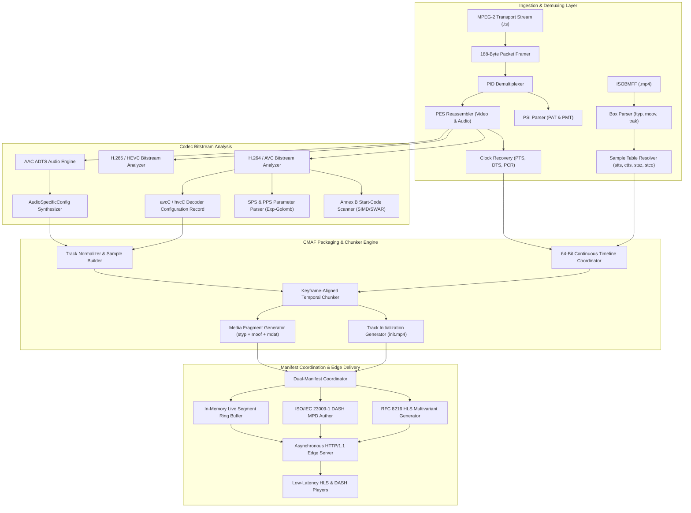

# Venturi Architecture & Internal Systems Design

Venturi is a high-throughput streaming media transmuxer, live segmented packager, and adaptive edge delivery engine written in Factor, featuring C99 SIMD fast-path acceleration and a Python validation test harness.

This document details the architectural layers, data pipelines, memory layouts, and algorithmic choices underpinning the engine.

---

## High-Level System Architecture



---

## 1. Demuxing & Ingestion Layer

The demuxing subsystem processes broadcast feeds (MPEG-2 TS) and file containers (ISOBMFF/MP4), extracting elementary streams without transcoding audio or video samples.

### 1.1 MPEG-2 Transport Stream Engine (`venturi.mpegts`)
MPEG-2 Transport Streams consist of fixed 188-byte packets starting with a synchronization byte (`0x47`).

```
+---------------+---------------+---------------+---------------+-------------------------------+
| Sync (0x47)   | Flags + PID   | Flags + CC    | Adaptation    | Payload Data (up to 184 B)    |
| (8 bits)      | (16 bits)     | (8 bits)      | (Optional)    |                               |
+---------------+---------------+---------------+---------------+-------------------------------+
```

The packet processor handles:
* **Framer (`venturi.mpegts.packet`)**: Identifies 188-byte framing boundaries, parses Transport Error Indicators, Payload Unit Start Indicators (PUSI), Transport Priority, and 13-bit Program Identifiers (PIDs).
* **Adaptation Field Decoder**: Recovers the 33-bit Program Clock Reference (PCR) base and 9-bit PCR extension (27 MHz system time clock) used for clock synchronization.
* **Program Specific Information (`venturi.mpegts.psi`)**:
  * Program Association Table (PAT, PID `0x0000`): Parses program numbers and resolves the Program Map Table (PMT) PID.
  * Program Map Table (PMT): Identifies elementary stream PIDs (H.264 `0x1B`, H.265 `0x24`, AAC `0x0F`, ID3 `0x15`).
  * Table validation verifies ISO/IEC 13818-1 CRC-32 checksums before accepting PSI sections.
* **PES Reassembler (`venturi.mpegts.pes`)**: Reconstructs fragmented Packetized Elementary Stream (PES) packets across consecutive TS packets. Recovers 33-bit Presentation Time Stamps (PTS) and Decode Time Stamps (DTS) using 90 kHz clock resolution.

### 1.2 ISOBMFF Monolithic Demuxer (`venturi.isobmff`)
For file-based input, Venturi implements a complete recursive box parser adhering to ISO/IEC 14496-12:
* Traverses root containers (`ftyp`, `moov`, `mdat`).
* Extracts movie header (`mvhd`) global timescales and track headers (`tkhd`).
* Resolves media header (`mdhd`) timescales, handler types (`hdlr`), and media information (`minf`).
* Evaluates sample table atoms (`stbl`): Time-to-Sample (`stts`), Composition Time-to-Sample (`ctts`), Sync Sample (`stss`), Sample-to-Chunk (`stsc`), Sample Size (`stsz`, `stz2`), and Chunk Offsets (`stco`, `co64`).

---

## 2. Codec Bitstream Processing (`venturi.codecs`)

Venturi inspects and transforms raw codec bitstreams to prepare them for MP4 encapsulation.

### 2.1 H.264 / AVC Bitstream Analyzer
* **Annex B Scanning**: Locates 3-byte (`0x000001`) and 4-byte (`0x00000001`) start codes.
* **Emulation Prevention Byte Removal**: Detects `0x000003` sequences and produces unescaped Raw Byte Sequence Payloads (RBSP).
* **Exponential-Golomb Coder (`venturi.common.exp-golomb`)**: Reads unsigned `ue(v)` and signed `se(v)` fields.
* **SPS Parsing**: Extracts profile indicator, level indicator, resolution from macroblock dimensions (`pic_width_in_mbs_minus1`, `pic_height_in_map_units_minus1`), and calculates frame cropping offsets (`frame_crop_left_offset`, `frame_crop_top_offset`).
* **avcC Record Construction**: Synthesizes the ISO/IEC 14496-15 AVCDecoderConfigurationRecord containing SPS and PPS arrays.
* **Annex B to Length-Prefixed Conversion**: Replaces Annex B start codes with 4-byte big-endian NAL unit length headers required for `avc1` sample storage in MP4.

### 2.2 H.265 / HEVC Bitstream Analyzer
* Parses NAL unit header (Forbidden zero bit, 6-bit NAL type, 6-bit Layer ID, 3-bit Temporal ID).
* Decodes HEVC Sequence Parameter Sets including profile tier level specifications, pic width and height in luma samples, and sub-layer limits.
* Synthesizes `hvcC` HEVCDecoderConfigurationRecord.

### 2.3 AAC ADTS Bitstream Engine
* Parses 7-byte Audio Data Transport Stream (ADTS) frame headers.
* Extracts sampling frequency index, channel configuration, and frame length.
* Synthesizes 2-byte AudioSpecificConfig records (`AudioSpecificConfig` / `esds`) mapping audio profile (AAC-LC) and channel layout into MP4 audio sample descriptions.

---

## 3. CMAF Packaging & Timeline Coordination (`venturi.packaging`)

CMAF (Common Media Application Format, ISO/IEC 23000-19) standardizes fragmented MP4 delivery across modern streaming ecosystems.

### 3.1 Keyframe-Aligned Temporal Chunker (`venturi.packaging.chunker`)
Streaming players require fragments to begin on closed instantaneous decoding refresh (IDR) keyframes:
* Scans video samples for IDR boundaries.
* Accumulates frames until target chunk duration (e.g. 2.0 seconds) is reached.
* Aligns audio samples to the exact temporal window defined by video keyframe PTS boundaries, ensuring zero media drift.

### 3.2 64-Bit Continuous Timeline Coordinator (`venturi.packaging.timeline`)
* Normalizes disparate input timestamps to a unified 64-bit continuous timeline.
* Detects and compensates for 33-bit MPEG-2 TS timestamp rollovers (occurring every 26.5 hours at 90 kHz).
* Eliminates clock drift across extended 24/7 broadcast feeds.

### 3.3 Fragment Construction (`venturi.packaging.cmaf`)
* **Track Initialization Segment (`init.mp4`)**: Contains `ftyp` (CMAF brand `cmf2`) and `moov` with track headers (`tkhd`, `mdhd`), media handlers (`hdlr`), sample descriptions (`stsd`), and movie extends (`mvex` with `trex` default sample properties).
* **Media Fragment Segment (`.m4s`)**: Begins with segment type (`styp`), followed immediately by movie fragment (`moof`), followed immediately by media data (`mdat`).
  * `moof` houses movie fragment header (`mfhd`) with monotonic sequence numbers.
  * `traf` houses track fragment header (`tfhd`) and track fragment decode time (`tfdt`) with 64-bit `baseMediaDecodeTime`.
  * `trun` houses run-length encoded sample metadata (sample duration, size, flags, composition time offset).

---

## 4. Manifest Coordination (`venturi.manifests`)

Venturi authors synchronized HLS and DASH manifests pointing to identical CMAF fragments on disk or in memory.

### 4.1 RFC 8216 HLS Engine (`venturi.manifests.hls`)
* **Multivariant Master Playlist (`master.m3u8`)**: Specifies variant streams with bandwidth, average bandwidth, resolution, framerate, and codec strings (`avc1.640028,mp4a.40.2`).
* **Media Playlist (`stream.m3u8`)**:
  * VOD Mode: Includes `#EXT-X-PLAYLIST-TYPE:VOD`, target duration, `#EXT-X-MAP:URI="init.mp4"`, `#EXTINF` segment tags, and `#EXT-X-ENDLIST`.
  * Live Mode: Implements a sliding window maintaining a configurable number of live segments, advancing `#EXT-X-MEDIA-SEQUENCE` synchronously.

### 4.2 ISO/IEC 23009-1 DASH Engine (`venturi.manifests.dash`)
* Authors XML MPD documents adhering to the `urn:mpeg:dash:profile:isoff-live:2011` schema.
* Generates `AdaptationSet` blocks for video and audio.
* Implements `SegmentTemplate` with run-length compressed `SegmentTimeline` (`<S t="..." d="..." r="..." />`).

---

## 5. Edge Server & Live Streaming (`venturi.server`)

Venturi includes a high-throughput, non-blocking HTTP/1.1 edge server tailored for streaming delivery.

### 5.1 High-Concurrency Live Segment Ring Buffer (`venturi.server.live-stream`)
* In-memory bounded circular buffer holding active live fragments.
* Atomic segment eviction when buffer capacity is exceeded.
* O(1) concurrent URI lookup mapping chunk names to byte buffers.

### 5.2 RFC 7233 Range Request Processor (`venturi.server.range-requests`)
* Parses standard ranges (`bytes=0-499`), open-ended ranges (`bytes=500-`), and suffix ranges (`bytes=-250`).
* Emits HTTP 206 Partial Content responses with formatted `Content-Range` headers.
* Rejects out-of-bounds requests with HTTP 416 Range Not Satisfiable.

### 5.3 Route Dispatcher & CORS Handling (`venturi.server.handler`)
* Automatic MIME type resolution (`application/vnd.apple.mpegurl`, `application/dash+xml`, `video/iso.segment`, `video/mp4`).
* Complete CORS preflight support (`OPTIONS` requests returning `Access-Control-Allow-Origin: *`, `Access-Control-Allow-Methods: GET, HEAD, OPTIONS`, `Access-Control-Allow-Headers: Range, Accept-Encoding`).
